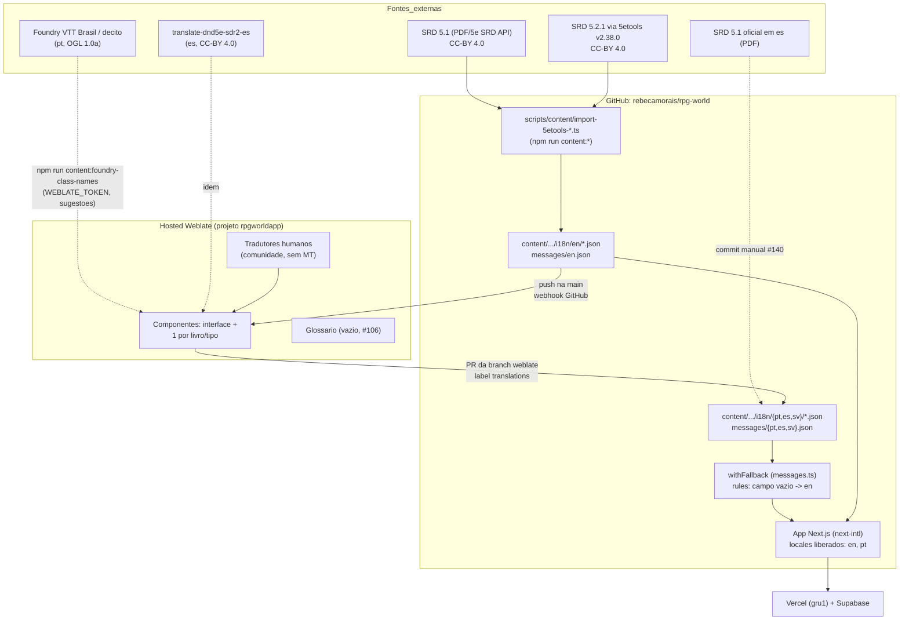

# 01. Estado atual da localização no RPGWorld

**Data da medição:** 2026-11-27, repositório em `3ad7d31d` (branch `claude/localization-infrastructure-discovery-a9d276`, sem alterações de código).
**Escopo:** só leitura do repositório e do `git`. Nada foi chamado fora da máquina: o que está no Weblate (progresso, glossário, memória de tradução, membros) **não foi consultado** e aparece aqui apenas como o repositório o descreve.
**Convenção:** "Fato" = observado no repositório. "Inferência" = conclusão minha a partir dos fatos. Números de volume estão no [02-translation-volume.md](02-translation-volume.md).

## 1. Resumo em dez linhas

1. A interface usa **`next-intl` 4.15.1** sobre **Next.js 16.4.6** (versões instaladas; `package.json` pede `^4.15.1` e `^16.4.6`). Mensagens em ICU, JSON aninhado.
2. Só **`en` e `pt` estão liberados** no app (`src/i18n/routing.ts`: `locales: ['en', 'pt']`). `es` e `sv` existem nos arquivos, mas o app não os oferece.
3. A plataforma é o **Hosted Weblate**, projeto `rpgworldapp`. O Weblate lê os arquivos direto do GitHub por webhook e devolve PRs. **Hoje não há GitHub Action de tradução nem arquivo de configuração do Weblate/Crowdin no repositório** (`git ls-files` não acha nenhum); até 2026-11-15 havia um fluxo do Crowdin em Actions, removido no #218 (seção 7).
4. A interface (`messages/*.json`) tem **1.652 strings**; as regras do SRD (`content/dnd5e/srd-5.{1,2}/i18n/`) têm **4.075** (soma dos dois livros); total do produto 5.727 strings, 160.246 palavras em inglês.
5. `messages/es.json` e `messages/sv.json` são `{}` (3 bytes). O conteúdo `es` é parcial (51,9% das chaves do produto, contando o `es` da interface como 0%) e o `sv` é só esqueleto vazio.
6. A fonte é sempre o inglês. O que falta aparece em inglês (fallback por chave na interface, por campo nas regras).
7. **Não existe glossário**: nem arquivo no repositório, nem convenção escrita. A issue #106 está citada nos docs como "ainda vazio".
8. Há uma **decisão registrada de "sem tradução automática, nem como rascunho"** (`docs/plans/2026-10-15-traducoes-comunitarias.md`). Esta descoberta a reverteria; ver seção 11.
9. Hospedagem: **Vercel** (região `gru1`) e **Supabase** (README e `vercel.json`).
10. Os e-mails transacionais (`src/backend/shared/infrastructure/email/templates/*.tsx`, ~15 KB de código) **não usam `next-intl` nem recebem locale** (nenhuma ocorrência de `locale`, `useTranslations` ou `getTranslations` nesses arquivos). Provável texto fixo, não medido.

## 2. Framework e versões

| Item              | Valor                                                                                                                                                                                                              | Fonte                                            |
| ----------------- | ------------------------------------------------------------------------------------------------------------------------------------------------------------------------------------------------------------------ | ------------------------------------------------ |
| Next.js           | 16.4.6 instalado (`^16.4.6`)                                                                                                                                                                                       | `package.json`, `node_modules/next/package.json` |
| next-intl         | 4.15.1 instalado (`^4.15.1`); sintaxe ICU (depende de `icu-minify`)                                                                                                                                                | idem                                             |
| Node              | 24.x                                                                                                                                                                                                               | `package.json` `engines`                         |
| Config de rota    | `defineRouting({ locales: ['en','pt'], defaultLocale: 'en', localePrefix: 'never' })`                                                                                                                              | `src/i18n/routing.ts`                            |
| Escolha do idioma | cookie `NEXT_LOCALE` (seletor) ou `Accept-Language`; o `proxy.ts` reescreve para `/<locale>/...` internamente; só as páginas públicas em `LOCALIZED_PATHS` têm endereço por idioma (`/pt/features`) com `hreflang` | `src/i18n/routing.ts`                            |
| Carregamento      | `src/i18n/request.ts`: `en` direto; outros idiomas por `import(\`messages/${locale}.json\`)`completados por`withFallback`                                                                                          | `src/i18n/request.ts`                            |
| Fuso              | fixo em `UTC`; nenhum componente formata data com `next-intl`                                                                                                                                                      | comentário em `request.ts`                       |
| Seletor de idioma | `src/frontend/components/LanguageSwitcher.tsx`, nomes fixos `{ en: 'English', pt: 'Português' }`                                                                                                                   | código                                           |

**Teste que protege a interface:** `src/frontend/messages.unit.test.ts` exige que `en` e `pt` tenham **exatamente as mesmas chaves**. Não há teste equivalente para `es`/`sv` (nem faria sentido: o Weblate deixa chaves de fora).

## 3. Formatos de arquivo

### 3.1 Interface: `messages/{en,pt,es,sv}.json`

- JSON aninhado por namespace (55 namespaces de primeiro nível, ex.: `common`, `parties`, `privacy`, `terms`, `features`…). As folhas são strings ou listas de strings (por exemplo, itens dos Termos).
- Chaves em `camelCase` (CONTRIBUTING, seção i18n).
- `en` 94.761 bytes, `pt` 99.040 bytes, `es` e `sv` 3 bytes (`{}`).
- Sintaxe ICU. Medido em `messages/en.json` (ver o 02, seção 4): 180 strings com `{variável}`, 19 com `plural`, 1 com `select`, 0 com `selectordinal`, 34 com marcação rica `<tag>…</tag>` (tags como `<bold>`, `<strong>`, `<b>`, `<i>`, e tags de link/ênfase nomeadas como `<supabase>`, `<vercel>`, `<discord>`, `<ccby>`, `<lgpd>`), 68 nomes de argumento distintos.
- **Atenção a branches de `select`/`plural` com palavra traduzível** (`{amount, select, all {all} other {{amount}}}`): o texto dentro das chaves é traduzível, o resto é código. Qualquer fluxo automatizado precisa preservar a estrutura e traduzir só os literais.

### 3.2 Regras: `content/dnd5e/srd-{5.1,5.2}/`

Há duas camadas por livro:

- **Dados mecânicos** (`spells.json`, `items.json`, `conditions.json`, `classes.json`): ids, nível, escola, componentes, dado de vida etc. **Nenhuma string com espaço (texto livre) neste nível** (medido: 0 em todos os oito arquivos). Não se traduz.
- **Textos traduzíveis** em `i18n/<idioma>/<tipo>.json`, um objeto por id de entrada, mesma estrutura em todos os idiomas, com o `en` como fonte:

| Tipo         | Forma                                                                                                                                                                                                | Campos traduzíveis (medido no `en`)                                                                                                           |
| ------------ | ---------------------------------------------------------------------------------------------------------------------------------------------------------------------------------------------------- | --------------------------------------------------------------------------------------------------------------------------------------------- |
| `spells`     | `{ "acid-arrow": { name, description, higherLevel, material, trigger? } }`                                                                                                                           | `name` (658), `description` (658), `higherLevel` (215), `material` (373), `trigger` (12)                                                      |
| `items`      | `{ "abacus": { name, description? } }`                                                                                                                                                               | `name` (467), `description` (217)                                                                                                             |
| `conditions` | `{ "blinded": { name, description } }`                                                                                                                                                               | `name` (30), `description` (30)                                                                                                               |
| `classes`    | `{ "barbarian": { name, subclassTitle, features: { id: { name, description } }, resources: { id: { name, note } }, choices: { id: { name } }, subclasses: { id: { name, features, resources } } } }` | `name` 24, `subclassTitle` 24, e por habilidade/recurso/escolha: `name`, `description`, `note`. Total de 1.367 strings (soma dos dois livros) |

- **Contagem de entradas:** 319 magias no 5.1, 339 no 5.2, 251 e 216 itens, 15 condições em cada, 12 classes em cada.
- Um idioma ainda não traduzido tem **as mesmas chaves com `""`** (caso do `sv`, e de campos pendentes em `pt`/`es`). Em `classes`, chaves de habilidade podem faltar (ex.: 1 a 8 chaves ausentes por livro/idioma, medido).
- **Marcação dentro do texto (a preservar):**
  - Tags no estilo 5etools: `{@condition charmed}`, `{@spell Water Breathing|XPHB}`, `{@variantrule Long Rest|XPHB}`, `{@damage 4d4}`, `{@dc 15}`, `{@scaledice 5d8|5-9|1d8}`… (3.349 ocorrências em 1.023 strings; 27 tipos, dominados por `variantrule` 901, `condition` 491, `item` 313, `spell` 299, `damage` 232).
  - **Algumas tags têm um terceiro segmento de texto de exibição que É traduzível**: `{@condition charmed||enfeitiçada}`, `{@variantrule Magical Effect|XPHB|magical effects}`. Medido: 555 tags com esse segmento. O primeiro e o segundo segmentos são identificadores (não traduzir).
  - Expressões de dado soltas (`1d8`, `4d4`): 621 no inglês, mais as dentro de `{@damage}`/`{@dice}`.
  - Tabelas em Markdown (77 linhas `|...|`), listas com `•` (370 linhas) e quebras de linha `\n` dentro da string (2.558).

### 3.3 Outros textos traduzíveis fora de JSON

- `public/llms.txt` (3.217 caracteres, em inglês; lista os idiomas oferecidos).
- Páginas públicas **legais e de marketing estão dentro de `messages/*.json`** (namespaces `terms`, `privacy`, `landing`, `features`, `seo`, `footer`, `translationInvite`), não em MDX.
- Capturas de tela da landing existem só em `pt` e `en` (`FeatureShowcase.tsx`, gerar com `npm run showcase`): são imagens com texto, fora do fluxo de strings.
- Documentação (`docs/`, `README.md`, `CONTRIBUTING.md` etc.) é escrita **em português** e não é traduzida por nenhum fluxo.

## 4. Idiomas de origem e de destino

| Camada         | Fonte                                                  | pt                                                                                                           | es                                                                                                           | sv              |
| -------------- | ------------------------------------------------------ | ------------------------------------------------------------------------------------------------------------ | ------------------------------------------------------------------------------------------------------------ | --------------- |
| Interface      | `en` (inglês escrito pela mantenedora)                 | completo, escrito no repositório                                                                             | vazio                                                                                                        | vazio           |
| Regras SRD 5.1 | `en` vindo da 5e SRD API / SRD oficial                 | magias e nomes de itens em grande parte, vindo do módulo Foundry VTT Brasil (OGL 1.0a), mais Crowdin/Weblate | magias e condições copiadas do **PDF oficial do SRD 5.1 em espanhol** (CC-BY 4.0), commit `71749aa7`/#140    | esqueleto vazio |
| Regras SRD 5.2 | `en` extraído do 5etools v2.38.0 (só entradas `srd52`) | quase só nomes (não existe fonte pt do SRD 5.2)                                                              | magias 98% preenchidas; classes parciais (módulo `translate-dnd5e-sdr2-es`, CC-BY 4.0, para nomes de classe) | esqueleto vazio |

**Fato:** o plano diz que `es` e `sv` "chegam pelo PR do Weblate antes de o app oferecer o idioma". **Inferência:** a origem do texto `es` das magias do 5.2 (98% preenchidas) não está documentada no repositório; os commits são "traduções do Crowdin" (#98, #102) e "update translations" (#224), então o texto entrou pela plataforma, sem dizer de qual fonte. Ver "Perguntas em aberto".

Para liberar um idioma é preciso mexer em 7 pontos (lista em `traducoes-comunitarias.md`, "Liberar um idioma novo"): `routing.ts`, `LanguageSwitcher.tsx`, os quatro `srd-*.ts` do backend (hoje **só `pt` é importado**, fixo: `srd-spells.ts` faz `import pt51/pt52` e passa `translations: { pt: ... }`), o `locale` do Open Graph em `app/[locale]/layout.tsx`, as capturas da landing e `llms.txt`. **Ou seja: para os dados de regras, `es` e `sv` não são lidos por nenhuma linha de código hoje**; os arquivos servem só ao Weblate.

## 5. Fluxo atual de ponta a ponta

Passo a passo (tudo isto é fato, vindo do plano e do código, salvo onde marcado):

1. **Fonte em inglês.** O texto da interface é escrito à mão em `messages/en.json` (e o português é escrito junto, à mão, na mesma PR, porque o teste exige as mesmas chaves em `en` e `pt`). O texto das regras é **gerado** por `npm run content:{spells,conditions,items,classes}` a partir do 5etools (versão fixada em `scripts/content/5etools-source.ts`), só entradas marcadas SRD.
2. **Push na `main`.** Um webhook do GitHub avisa o Weblate; chaves novas em inglês aparecem lá para traduzir. Não há Action nem comando de sincronização.
3. **Tradução no Weblate.** Pessoas traduzem e revisam. Sugestões externas (módulos do Foundry) entram por `npm run content:foundry-class-names`, que usa `WEBLATE_TOKEN` (ou `~/.config/weblate`) e envia como **sugestões** (`method=suggest`), sem sobrescrever o que já tem tradução.
4. **PR do Weblate.** O Weblate abre PR (branch `weblate`, de um fork, label `translations`) com os `messages/<idioma>.json` e `content/.../i18n/<idioma>/*.json`. A mantenedora revisa e faz o merge como em qualquer PR. **Sem merge automático.**
5. **Fallback.** Interface: `withFallback(translated, en)` completa por chave (e remove chaves que o inglês não tem mais). Regras: campo vazio ou ausente vira o inglês do campo, com selo "Em inglês" quando é a descrição.
6. **Publicação.** Deploy da `main` na Vercel (`vercel.json`: só `main` faz deploy; branches e PRs não).
7. **Traduções escritas direto no repositório** (por exemplo o português de uma funcionalidade nova) entram na `main` normalmente e o Weblate as lê de lá.

## 6. Scripts existentes

| Comando                                                          | Arquivo                                                                                                             | O que faz                                                                                                                                                                                                                             |
| ---------------------------------------------------------------- | ------------------------------------------------------------------------------------------------------------------- | ------------------------------------------------------------------------------------------------------------------------------------------------------------------------------------------------------------------------------------- |
| `npm run content:spells` / `:conditions` / `:items` / `:classes` | `scripts/content/import-5etools-*.ts` (+ `5etools-*.ts`)                                                            | Importa do 5etools (v2.38.0 fixada) só o SRD; gera `content/.../*.json` e `i18n/en/*.json`; tabelas de classe via `class-tables.ts`, recursos via `class-resources.ts`                                                                |
| `npm run content:foundry-class-names`                            | `scripts/content/import-foundry-class-names.ts`, `foundry-class-names.ts`, `foundry-names.ts`, `foundry-sources.ts` | Lê traduções de módulos do Foundry (pt-BR: `gitlab.com/fvtt-brasil/dnd5e` e `decito/dnd5e-pt-br`; es: `foundryvtt-sinregistrar/translate-dnd5e-sdr2-es`, todas fixadas por commit) e envia nomes de classes como sugestões ao Weblate |
| (biblioteca)                                                     | `scripts/content/weblate-translations.ts`                                                                           | Cliente da API do Weblate (`https://hosted.weblate.org/api/`), só `uploadSuggestions`; projeto `rpgworldapp`; `componentOf` (`srd-5.2` + `classes` → `srd-5-2-classes`), `languageOf` (`pt`→`pt_BR`)                                  |
| (sem script npm)                                                 | `scripts/content/tag-conditions.ts`, `tag-conditions-51.ts`                                                         | Marcam menções a condições com `{@condition …}` nos textos; existem como arquivos, mas `package.json` não tem comando para eles                                                                                                       |
| `npm run showcase`                                               | `scripts/capture-showcase.ts`                                                                                       | Capturas da landing por idioma                                                                                                                                                                                                        |

Testes que tocam i18n: `src/frontend/messages.unit.test.ts` (chaves en = pt, sem "username" no pt, referências da Privacidade), `src/i18n/messages.unit.test.ts`, `src/i18n/routing.unit.test.ts`, `proxy.language-switch.unit.test.ts`, `scripts/content/*.unit.test.ts`, `content/dnd5e/content.unit.test.ts`.

## 7. Configuração do Crowdin/Weblate que sobrou no repositório

- **Havia um fluxo do Crowdin em Actions e foi removido em 2026-11-15** (`c9882aa0`, #218): `crowdin.yml` e `.github/workflows/{crowdin,crowdin-foundry,crowdin-status}.yml` (disparo manual ou comentário `/sync-crowdin` só do dono; enviava o inglês e as traduções do repositório, e abria PR com as aprovadas). O mapeamento de arquivos dele ainda está no histórico (`git show c9882aa0^:crowdin.yml`): fonte `/messages/en.json` → `/messages/%two_letters_code%.json`, e `/content/dnd5e/**/i18n/en/*.json` → `/content/dnd5e/**/i18n/%two_letters_code%/%original_file_name%` com `skip_untranslated_strings: true`. É a melhor pista de como o Weblate está configurado (**inferência**, não verificado).
- **Hoje**: nenhum `crowdin.yml`, `.weblate`, `.l10n`, `*.po`, `*.xliff`, `*.tmx` ou glossário (`git ls-files | grep -i 'crowdin\|weblate\|glossar\|\.po$\|\.xliff\|\.tmx'` só devolve os dois arquivos `scripts/content/weblate-translations*`). **A configuração do Weblate (componentes, máscara de arquivo, add-ons, glossário, memória) vive só no servidor do Weblate**, não no repositório. Se a conta ou o projeto sumisse, a configuração teria de ser refeita de memória.
- Referências a Weblate: `README.md` (selos e seção "Traduções"), `.github/ISSUE_TEMPLATE/config.yml` (link para `https://hosted.weblate.org/engage/rpgworldapp/`), a mensagem `translationInvite` da interface ("Translate on Weblate"), `docs/`.
- **Resíduos do Crowdin em texto:** `docs/superpowers/specs/2026-11-14-traducoes-do-foundry-classes-design.md` (cabeçalho e corpo ainda falam em Crowdin, `/sync-crowdin`, "assistente Gemini no editor do Crowdin"), `docs/plans/2026-10-15-5etools-e-traducoes.md` (cita Crowdin e "tradução automática (LLM, com glossário versionado no repo)"), mensagens de commit antigas ("i18n: traduções do Crowdin"). O `docs/INDEX.md` já marca que o Foundry spec foi atualizado pelo #218, mas o corpo do spec não.
- O Crowdin contava ~5,4 mil strings e ~158 mil palavras (informação do pedido). **Confere** com a medição atual: 5.727 strings e 160.246 palavras, incluindo as regras 5.1+5.2 e a interface.

## 8. Quando e como o conteúdo localizado chegou (histórico do git)

- Primeiro commit do repositório: 2026-02-19 (data do commit; o pedido citava 2026-02-06, provavelmente a data de criação local ou do repositório no GitHub, não verificada).
- `messages/en.json` e `messages/pt.json` nascem em **2026-02-22** (`1b8d23d9`, "Introduce internationalization with next-intl"). 125 commits tocam `messages/en.json`; 402 commits no total.
- O conteúdo de regras em arquivo (`content/**/i18n/`) chega em **2026-10-21** (`5eadcb0a`, "magias oficiais em arquivo"); o SRD 5.2 de magias em 2026-10-22 (`21be6722`); condições em 2026-11-01; itens em 2026-11-03; **classes em 2026-11-13** (`9be56f6c`). Antes disso as magias viviam em tabelas do Postgres (`spells`, `spell_translations`), removidas em `20261022120000_drop_spells_tables.sql`.
- Crowdin entre 2026-10-23 e 2026-11-14 (commits "i18n: traduções do Crowdin", PRs do próprio fluxo `crowdin.yml`); Weblate desde 2026-11-15: #218 fez a troca e o primeiro PR do bot `hosted-weblate[bot]` é `70c15360` ("chore(l10n): update translations", #224). Confirmado: o autor do #224 é `hosted-weblate[bot]`.
- Autoria: 354 de 402 commits de duas variações do nome da mantenedora, 25 do bot `rebs-assistant[bot]`, 16 do Dependabot, 5 do `github-actions[bot]`. É uma pessoa só.

## 9. Como o conteúdo estruturado é localizado e cai no fallback

- **Interface:** `withFallback` (`src/i18n/messages.ts`) segue a **forma do inglês**: cada folha traduzida e não vazia vence; senão vale o inglês. Chaves que só existem no idioma-alvo são descartadas. Funciona recursivamente em objetos e listas (a lista usa o índice).
- **Regras (magias):** `src/backend/contexts/spells/infrastructure/srd-spells.ts` carrega, por livro, os dados mecânicos, os textos `en` e as traduções `pt` com `zod`; `FileSpellCatalog` junta e cai no inglês por campo. O selo "Em inglês" aparece quando a descrição está em inglês. Padrão equivalente nos `srd-*.ts` de itens, condições e classes. **Só `pt` é lido; `es`/`sv` não.**
- **Granularidade da tradução:** por campo, não por entrada. Isso significa que uma magia pode ter nome em português e descrição em inglês (acontece no `pt`: somando os dois livros, nomes 96% e descrições 48%; só no 5.2, 313 de 339 nomes de magia e nenhuma descrição, conferido na revisão adversarial).

## 10. Glossário e convenções de terminologia

- **Glossário:** não existe arquivo nem conjunto de termos no repositório. O plano cita que o projeto Weblate tem um componente de glossário **vazio** (#106), com exemplos a fazer: "saving throw" → "salvaguarda", "spell slot" → "espaço de magia".
- **Terminologia de fato** (escolhas já tomadas, achadas nos docs e no teste): "salvaguarda" (não "teste de resistência"), "espaço de magia", "nome de usuário" no lugar de "username" no texto pt (teste `messages.unit.test.ts` falha se "username" aparecer no pt fora de `{username}`), "Meu perfil". Estão **só no uso, não num documento**: `docs/INDEX.md`, lista de "Lacunas conhecidas", não menciona terminologia; a regra de idioma de código/docs/commits também é "prática observada, não escrita".
- Os termos de regras do pt herdam do Foundry VTT Brasil (para o 5.1) e do módulo `decito/dnd5e-pt-br` (nomes de classes do 5.2). O Foundry VTT Brasil é licenciado em OGL 1.0a no texto; o plano marca isso como questão em aberto no NOTICE.

## 11. Decisões existentes que a nova descoberta afetaria

| Decisão registrada                                                                                                                    | Onde                                                                                                                                                                | Relação com a descoberta                                                                                                                                                                                                |
| ------------------------------------------------------------------------------------------------------------------------------------- | ------------------------------------------------------------------------------------------------------------------------------------------------------------------- | ----------------------------------------------------------------------------------------------------------------------------------------------------------------------------------------------------------------------- |
| "Sem tradução automática, nem como rascunho"                                                                                          | `docs/plans/2026-10-15-traducoes-comunitarias.md`, "Decisões que mudaram desde o plano original"; objetivo do plano: "feito em comunidade, sem tradução automática" | **A descoberta (tradução com IA/LLM) reverteria esta decisão.** Convém registrar a reversão, ou o escopo da exceção (rascunho marcado, só para idiomas sem comunidade, etc.), num plano novo e atualizar o `INDEX.md`   |
| "Tradução automática (LLM, com glossário versionado no repo) só para o que não existir em nenhuma fonte, gravada como não verificada" | `docs/plans/2026-10-15-5etools-e-traducoes.md` (versão anterior do plano, de 15/10)                                                                                 | **Contradiz o plano de 23/10 e 15/11.** Mostra que a ideia de MT marcada como "não verificada" já foi aceita antes de ser descartada. O plano de 5etools ainda não foi marcado como superado neste ponto                |
| "Nada de IA no pipeline" (script determinístico, sem tokens)                                                                          | `docs/superpowers/specs/2026-11-14-traducoes-do-foundry-classes-design.md`, "Intenção"                                                                              | Vale para o **script do Foundry**, não proíbe o resto, mas mostra a preferência por reaproveitar tradução existente antes de gastar tokens                                                                              |
| Conteúdo em arquivo, não no banco; `is_verified` por linha deixou de existir                                                          | `traducoes-comunitarias.md`                                                                                                                                         | Se o resultado de IA precisa de "rascunho vs. verificado", **hoje não há campo para isso**: o arquivo só tem o texto. Seria preciso metadado externo (Weblate: estado "precisa de edição"/sugestão) ou arquivo separado |
| `es` e `sv` "não edite à mão"                                                                                                         | `.agents/rules/RULES_REFERENCE.md`, `docs/INDEX.md`                                                                                                                 | Qualquer geração automática para `es`/`sv` precisaria passar pelo Weblate (como sugestão) ou mudar essa regra                                                                                                           |
| "Em dúvida, não traduz; melhor faltar do que errar"                                                                                   | Foundry spec, "Como casar as entradas"                                                                                                                              | Princípio de qualidade que um fluxo de IA deveria declarar se mantém                                                                                                                                                    |

Também relevante para o desenho: **a mantenedora faz o merge de cada PR do Weblate** (memória de projeto: "ela faz o merge; sem menu"), e a regra de trabalho é PR com descrição em português e inglês. Um fluxo automático que abra PRs grandes precisa respeitar isso.

## 12. Conteúdo gerado versus mantido à mão

| Conteúdo                               | Origem                                                            | Pode ser regenerado?                                                              |
| -------------------------------------- | ----------------------------------------------------------------- | --------------------------------------------------------------------------------- |
| `content/**/<tipo>.json` (mecânica)    | Importador 5etools / 5e SRD API                                   | Sim, `npm run content:*` (versão fixada)                                          |
| `content/**/i18n/en/*.json`            | Importador (texto), com tags `{@…}` e markup                      | Sim                                                                               |
| `content/**/i18n/pt                    | es/*.json`                                                        | Weblate + commits manuais (importação do PDF `es` do 5.1, #140; ajustes de nomes) | **Não**: é a única cópia das traduções revisadas |
| `content/**/i18n/sv/*.json`            | Esqueleto vazio                                                   | Sim (derivável do `en`)                                                           |
| `messages/en.json`, `messages/pt.json` | À mão, na mesma PR da funcionalidade                              | Não                                                                               |
| `messages/es.json`, `messages/sv.json` | Weblate (hoje `{}`)                                               | —                                                                                 |
| `NOTICE.md`, Termos                    | À mão; o plano prevê gerar de `content-sources.json` (não existe) | —                                                                                 |

Risco apontado em commit: o sync do Crowdin (#139) **descartou traduções idênticas ao inglês** (Glaive, Piton, Totem, Perfume) e deixou o nome vazio; foi corrigido à mão em `71749aa7`. Mostra que ida e volta por plataforma pode perder dados quando o texto traduzido é igual ao fonte.

## 13. Infraestrutura e hospedagem

| Item                 | Fato                                                                                                                                                                                                                                                                                                                           | Fonte                 |
| -------------------- | ------------------------------------------------------------------------------------------------------------------------------------------------------------------------------------------------------------------------------------------------------------------------------------------------------------------------------ | --------------------- |
| Hospedagem do app    | **Vercel**, região `gru1` (São Paulo), cron diário `/api/cron/cleanup-avatars`, deploy só da `main` (`git.deploymentEnabled`: `main: true`, `**: false`)                                                                                                                                                                       | `vercel.json`         |
| Banco e auth         | **Supabase** (Postgres com RLS, Auth, Storage, Realtime); migrações aplicadas por `.github/workflows/deploy-migrations.yml`                                                                                                                                                                                                    | README, workflows     |
| E-mail               | `resend` e `nodemailer`, templates `react-email`                                                                                                                                                                                                                                                                               | `package.json`        |
| CI                   | GitHub Actions: `test.yml` (tsc, lint, knip, testes unitários com piso de cobertura, integração com Supabase local, e2e Playwright), `deploy-migrations.yml`, `dependabot-auto-merge.yml`, `discord-merges.yml` (avisa no Discord cada PR mergeado), `e2e-flake-hunt.yml` (cron semanal). **Nenhum workflow toca em tradução** | `.github/workflows/*` |
| Tradução             | Hosted Weblate, plano gratuito para software livre, projeto público `rpgworldapp`                                                                                                                                                                                                                                              | docs, README          |
| Comunidade           | Discord (canal de suporte, tradução e comunidade), GitHub Discussions só Anúncios e Ideias                                                                                                                                                                                                                                     | memória de projeto    |
| Licenças do conteúdo | GPLv3 (código); SRD 5.1/5.2 em CC-BY-4.0; 5e SRD API em MIT; Foundry VTT Brasil em OGL 1.0a; `translate-dnd5e-sdr2-es` em CC-BY-4.0. Créditos em `NOTICE.md` e nos Termos                                                                                                                                                      | `NOTICE.md`, README   |

**Máquina local do mantenedor (do pedido, não verificada aqui):** WSL2, 24 threads, ~15 GB de RAM visíveis, GPU NVIDIA RTX 5070 Laptop com 8 GB de VRAM.

## 14. Observações que podem importar para o desenho

- **Paridade entre fonte e idiomas de regras só em parte.** `content/dnd5e/content.unit.test.ts` já confere, por campo e por idioma, a paridade das tags `{@…}` e a marcação sem fechar (corrigido na revisão adversarial; a primeira versão deste doc dizia que não havia teste). **Não há** verificação de dados soltos (`1d8`), de números nem de placeholders ICU nas traduções. Atenção: 186 das 319 descrições de magia em pt do 5.1 têm números diferentes do inglês porque convertem pés em metros, então "números iguais" não serve de regra. O script de medição desta descoberta calcula uma checagem de paridade aproximada (02, seção 5): na interface, 11 "quebras" no `pt`, todas aparentemente falsos positivos (palavras dentro de branches de `select`/`plural`); no conteúdo, 13 em magias 5.1 `pt` e 15 em magias 5.1 `es` (0 nas demais categorias), que precisam de inspeção manual (um exemplo: `srd51:spells/pt/bane.description`, onde o inglês diz "d4" e o pt "1d4").
- **Nada guarda "traduzido a partir de qual versão do inglês".** A defasagem só é inferível por data de commit (02, seção 6).
- **Chaves de classe usam ids estáveis** (`features.rage`), o que é bom para memória de tradução: o par id→texto é estável entre 5.1 e 5.2 quando o nome é igual (119 de 675 strings de classes são idênticas entre livros).

## Limitações

- **Weblate não foi consultado.** Progresso, glossário, memória de tradução, add-ons, componentes configurados e membros estão descritos só como os docs os relatam. O que o Weblate "sabe" pode divergir do repositório.
- Nada foi executado do app (`next dev`); a leitura do fluxo de fallback das regras vem do código dos `srd-*.ts`, lido por amostragem (magias em detalhe, os demais pelo padrão descrito no plano).
- Os e-mails transacionais e mensagens de erro do backend (`error-codes`, `client-messages`) não foram contados nem inspecionados em detalhe; podem conter texto fixo ou chaves fora de `messages/`.
- Conteúdo ainda **não importado** do SRD (criaturas ~320-330 por edição, itens mágicos, talentos, antecedentes, espécies, glossário de regras; ver `docs/plans/2026-11-26-srd-o-que-falta.md`) não existe no repositório e não está nos números.
- Datas de commit são as do merge (committer date). Os commits do Crowdin/Weblate e dos importadores pesam como qualquer outro.
- Conteúdo gerado por usuários (nomes de personagem, notas, homebrew) não é traduzível e ficou fora.

## Nível de confiança

| Afirmação                                                     | Confiança | Por quê                                                                                                 |
| ------------------------------------------------------------- | --------- | ------------------------------------------------------------------------------------------------------- |
| Stack (Next 16.4.6, next-intl 4.15.1), `locales: ['en','pt']` | alto      | lido do `package.json`, `node_modules` e `routing.ts`                                                   |
| Não há Action, `crowdin.yml` nem config do Weblate no repo    | alto      | `git ls-files` e leitura dos 5 workflows                                                                |
| O Weblate lê por webhook e abre PRs de uma branch `weblate`   | médio     | vem do plano `traducoes-comunitarias.md` e dos commits do Weblate; o webhook em si não foi inspecionado |
| Formato e campos traduzíveis de cada tipo de regra            | alto      | medido nos JSON                                                                                         |
| Só `pt` é lido pelo backend de regras                         | alto      | `srd-spells.ts` (código lido); itens/condições/classes inferidos do padrão e do plano                   |
| Origem do texto `es` das magias do 5.2                        | baixo     | não documentada                                                                                         |
| Os e-mails não usam i18n                                      | médio     | busca textual negativa, sem leitura dos templates                                                       |
| Decisão "sem MT, nem rascunho" é a vigente                    | alto      | texto do plano de 15/11, mais recente que o plano de 5etools que dizia o contrário                      |
| Hospedagem Vercel + Supabase                                  | alto      | `vercel.json`, README, workflows                                                                        |
| Terminologia só em uso, não documentada                       | médio     | busca por glossário/terminologia em `docs/`, README, CONTRIBUTING, NOTICE sem resultado                 |

## Perguntas em aberto

1. Qual é a configuração real do projeto no Weblate (componentes, máscaras de arquivo, add-ons como "Automatic translation", "Squash Git commits", regras de revisão, quem pode aprovar)? Convém exportá-la ou descrevê-la num doc.
2. O glossário (#106) continua vazio no Weblate? Existe alguma lista de termos informal (chat, notas) que possa virar o glossário inicial?
3. De onde veio o texto `es` das magias do SRD 5.2 (98% preenchido)? Tradução oficial do SRD 5.2.1 em espanhol, módulo do Foundry, MT do Crowdin, tradutor humano? Isso define a licença e a confiança desse conteúdo.
4. A decisão "sem tradução automática" será revertida inteira ou só para idiomas sem comunidade e como rascunho marcado? O `INDEX.md` e o plano de traduções precisam ser atualizados no mesmo PR.
5. Os e-mails (Resend/react-email) e as mensagens de erro do backend devem ser localizados? Hoje parecem fora do fluxo.
6. Quando `es`/`sv` forem liberados, o backend de regras precisa ler esses idiomas (hoje fixo em `pt`). Quer-se um carregamento por idioma liberado (como o plano sugere) antes ou depois da descoberta de infraestrutura?
7. Onde guardar o estado "rascunho de máquina" vs. "revisado por humano" para conteúdo em arquivo (`is_verified` foi removido)? Estado do Weblate, arquivo-lateral ou convenção de caminho?
8. As variantes regionais importam? O plano usa `pt` ligado a `pt_BR` por apelido; um `pt-PT` ou `es-MX` exigiria mudar nomes de arquivo.
