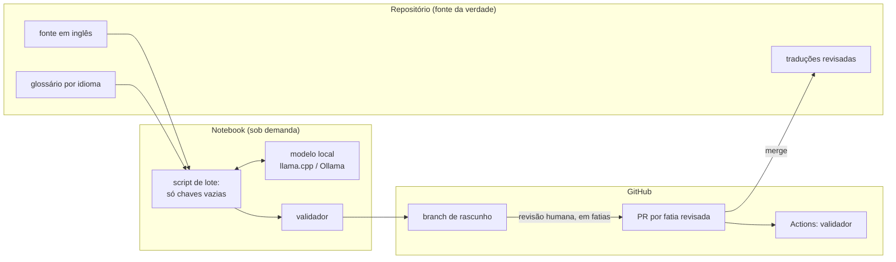
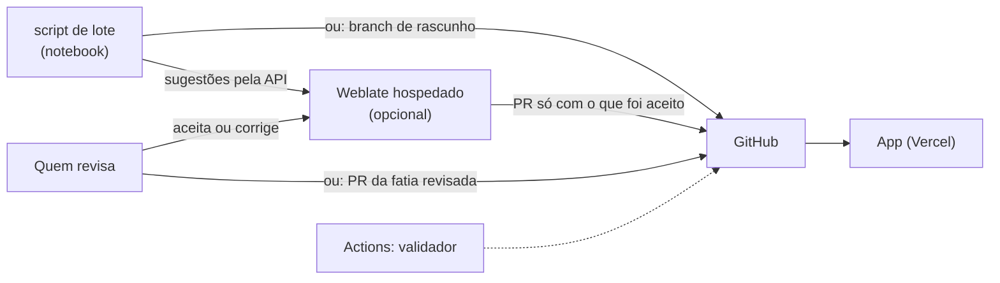
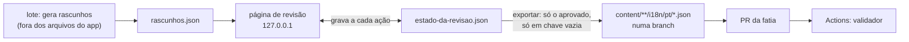
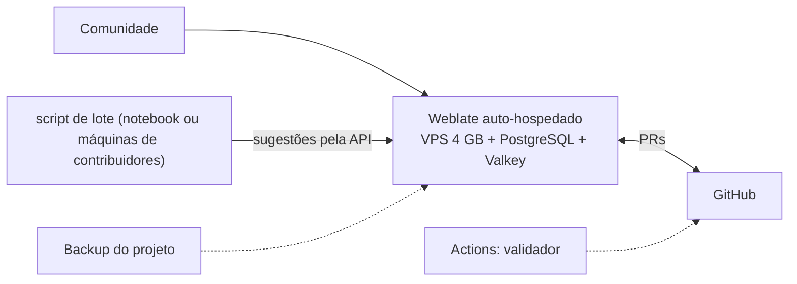

# 07 — Arquiteturas

**Data:** 2026-11-27 (revisado depois da [revisão adversarial](research/adversarial-review.md)). Desenho, não implementação. Nada aqui foi construído nem testado; os pontos marcados **[a testar]** são hipóteses que o [plano de experimentos](10-poc-plan.md) confere.

## Regra que simplifica tudo

**Texto de máquina só entra na `main` depois que uma pessoa revisou.** É a regra que o projeto já segue ("o que está no arquivo, aceito, é o que vale"). Com ela:

- o app não muda (nenhum selo novo);
- não é preciso marcar no arquivo o que é de máquina;
- "chave vazia na `main`" continua significando "falta traduzir".

Publicar rascunho não revisado com selo é uma decisão separada, da Rebeca, tratada na seção 7.

## 1. Arquitetura mínima (estratégia F)

Três peças, nenhuma sempre ligada:

1. **Script de lote** (dentro do repositório, GPL-3.0 como o app): lê as chaves vazias de um idioma, **mascara as tags `{@…}`** (o PoC 1 mostrou que o modelo traduz os identificadores em 38% das strings com tag se elas forem enviadas cruas), traduz em lotes no modelo local com o glossário no prompt, passa pelo validador e grava numa **branch de rascunho**. Não toca em chave preenchida. Pode ser o `i18n-ai-translate` adaptado, se o PoC 3 passar.
2. **Validador determinístico:** o mesmo código roda no notebook e no CI, em todo PR que toque tradução.
3. **Revisão em fatias:** a pessoa revisa um pedaço (um nível de magia, uma classe), corrige e abre PR só daquela fatia.

## 2. Recomendação principal (estratégia G)

A mínima, com o Weblate hospedado como tela de revisão que pode sair sem deixar buraco:

- **Com Weblate:** o script envia a saída como **sugestão**, pelo mesmo caminho que `scripts/content/weblate-translations.ts` já usa para os nomes do Foundry. Só o que alguém aceita chega ao repositório. O Weblate cuida de memória, glossário na tela e aviso de "a fonte mudou".
- **Sem Weblate:** branch de rascunho e PR por fatia, como na mínima.
- **Regra de convivência:** enquanto o Weblate estiver ligado a um idioma, o script **não escreve nos arquivos daquele idioma**; só sugere. Assim não há dois escritores no mesmo arquivo.

Esta arquitetura usa o fluxo da estratégia B (sugestões) sem depender dele: se o Weblate sair, troca-se o destino da saída.

## 3. Como os requisitos são atendidos

| Requisito                         | Agora                                                                                                                                                                    | Onde             |
| --------------------------------- | ------------------------------------------------------------------------------------------------------------------------------------------------------------------------ | ---------------- |
| Tradução incremental              | Chave vazia = falta traduzir                                                                                                                                             | Arquivos         |
| Fonte mudou, tradução ficou velha | O Weblate marca enquanto estiver ligado. Sem ele, só com a trava (seção 6)                                                                                               | Weblate / adiado |
| Memória exata                     | Mapa `(componente, campo, fonte) → alvo` montado dos próprios arquivos a cada execução                                                                                   | Git              |
| Memória com contexto              | A chave inclui componente e campo. Entre contextos, só como exemplo no prompt, nunca cópia. Motivo: a propagação do Weblate já trocou o item "Shield" pelo nome da magia | Script           |
| Memória difusa                    | Não construir. O prompt recebe 2 ou 3 pares aprovados do mesmo tipo como exemplo                                                                                         | Script           |
| Glossário                         | Um CSV por idioma no repositório, que o Weblate também importa. Entra no prompt e é conferido depois                                                                     | Git              |
| Versões                           | `git log`                                                                                                                                                                | Git              |
| Estados de aprovação              | Na `main` = revisado. Fora dela (sugestão ou branch) = rascunho                                                                                                          | Git / Weblate    |
| Não sobrescrever aprovado         | O script só preenche chave vazia                                                                                                                                         | Script           |
| Preservar estrutura               | Traduz só as folhas de texto e remonta o JSON na mesma ordem e indentação                                                                                                | Script           |
| Validação determinística          | Seção 4                                                                                                                                                                  | CI               |
| Retomar, repetir                  | Rodar de novo pula o que já foi gerado na branch. Idempotente por construção                                                                                             | Script           |
| Lotes e concorrência              | Lotes por tamanho de contexto; paralelismo igual aos slots do servidor do modelo                                                                                         | Script           |
| Importar e exportar               | Os arquivos já são o formato                                                                                                                                             | —                |
| Vários repositórios               | Configuração por arquivo (fontes, alvos, campos). Extrair pacote só com um segundo usuário real                                                                          | Adiado           |

**O Git substitui o banco?** Sim, nesta escala (5.727 strings; a 10× são ~57 mil). O que ele não dá é concorrência entre muitas pessoas editando ao mesmo tempo, que é justamente quando o Weblate passa a valer um servidor.

## 4. Validador

Falha bloqueia o merge. O que já existe e o que falta:

| Verificação                                                                                                           | Estado                                               |
| --------------------------------------------------------------------------------------------------------------------- | ---------------------------------------------------- |
| Tags `{@…}` e marcação preservadas, por campo e por idioma                                                            | **Já existe** (`content/dnd5e/content.unit.test.ts`) |
| Mesmas chaves entre `en` e `pt` na interface                                                                          | **Já existe** (`src/frontend/messages.unit.test.ts`) |
| ICU: mensagem analisável, mesmos argumentos, mesmas tags, mesmas chaves de `select`, categorias de `plural` do idioma | Falta                                                |
| Dados soltos (`2d6`, `1d8 + 3`) iguais aos da fonte                                                                   | Falta                                                |
| Números, **com unidades**                                                                                             | Falta, e precisa de decisão (abaixo)                 |
| Glossário: termo na fonte → forma aceita no alvo                                                                      | Falta                                                |
| Sanidade: sem sobra de prompt, sem colchetes em inglês, tamanho dentro de uma faixa                                   | Falta                                                |

**Unidades.** 186 das 319 descrições de magia aprovadas em pt do SRD 5.1 têm números diferentes do inglês, porque convertem pés em metros; o es do 5.2 mantém os números do inglês. Uma verificação "números iguais" barraria tradução boa. O validador precisa de uma convenção escrita por idioma (converte ou não, e com qual tabela: 5 pés = 1,5 m) e conferir a conversão, não a igualdade. **Essa convenção ainda não existe e é decisão da Rebeca.**

**O que o validador não pega:** vantagem trocada por desvantagem, o atributo errado de um teste, "metade em caso de sucesso", tipo de ação. Erro de regra só se pega lendo. Por isso a regra do topo.

Quando o modelo falha na validação, o script tenta de novo algumas vezes e, se não passar, deixa a chave vazia.

## 5. Onde cada peça roda

| Peça                        | Onde                                         | Por quê                                                                        |
| --------------------------- | -------------------------------------------- | ------------------------------------------------------------------------------ |
| Fonte, traduções, glossário | Repositório no GitHub                        | Já é assim                                                                     |
| Tradução por máquina        | Notebook (WSL2, RTX 5070, 8 GB)              | Nenhuma nuvem gratuita tem GPU; o volume cabe em horas                         |
| Validação                   | GitHub Actions                               | É CI do próprio projeto; segundos por execução                                 |
| Revisão                     | Weblate hospedado (opcional) ou PR por fatia | Já configurado                                                                 |
| Inferência no Actions       | **Não**                                      | Os termos limitam o uso ao trabalho do próprio software, e sem GPU seria lenta |

**Contribuidores com máquina própria:** fork, mesmo script, PR. Sem segredo e sem permissão de escrita. O CI valida no gatilho `pull_request`, sem segredos; `pull_request_target` com checkout do código do PR não é usado.

## 6. Adiado: trava de hashes

Só vale construir quando existir fluxo recorrente **sem** Weblate (por exemplo, se o plano hospedado sair e a interface continuar mudando todo mês). Desenho, já com as correções da revisão:

- **Onde:** pasta própria fora de `messages/` e de `content/**/i18n/` (por exemplo `l10n/locks/`). Um arquivo `messages/pt.lock.json` casaria com a máscara do Weblate como se fosse um idioma.
- **O que guarda, por chave:** hash da fonte quando foi traduzida, motor usado, hash dos **termos de glossário que aparecem naquela string** (não do glossário inteiro, senão um termo novo invalida tudo) e uma marca `reviewed`.
- **Estados:** só `reviewed: true` conta como revisado. Valor diferente do que a máquina escreveu é "editado, não revisado", nunca "aprovado". Entrada apagada não promove nada.
- **Hash sobre o valor analisado**, não sobre o texto do arquivo, para não depender de formatação.
- **Fonte mudou:** rascunho não revisado é refeito; texto revisado só entra num relatório.

## 7. Decisão separada: publicar rascunho com selo

Alternativa à regra do topo: gravar o rascunho direto nos arquivos e mostrar no app um selo "tradução automática", no lugar do selo "Em inglês".

- **A favor:** quem não lê inglês recebe algo em vez de nada.
- **Contra:** a descrição de uma magia é regra. Um erro que muda a mecânica aparece com cara de texto oficial, e o validador não pega esse tipo de erro. Exige mudança no app, a trava da seção 6 e uma nota no `NOTICE.md` (a CC-BY-4.0 pede indicar modificações).
- **Recomendação:** não fazer agora. Reavaliar depois do PoC 2, com a taxa de erro mecânico medida.

## 7A. Revisão local (proposta de 27/11, nada construído)

A revisão é o gargalo, então é a peça que mais merece cuidado. Proposta: **uma página só, servida por um script Node sem dependências em `127.0.0.1`, com o estado gravado num arquivo JSON no disco.**

| Necessidade                     | Como                                                                                                                                     |
| ------------------------------- | ---------------------------------------------------------------------------------------------------------------------------------------- |
| Fonte e tradução lado a lado    | Duas colunas; tags `{@…}` mostradas como etiquetas, não como código                                                                      |
| Elementos mecânicos em destaque | Números, dados, CDs, unidades convertidas e condições coloridos nos dois lados; o que o código protegeu aparece marcado como "do código" |
| Glossário no contexto           | Termos do glossário presentes no segmento, listados ao lado; termo fora do glossário sublinhado                                          |
| Correção na hora                | A coluna da tradução é editável; o validador roda a cada edição e mostra o erro                                                          |
| Severidade e veredito           | Teclas: `1` a `4` veredito, `0` a `4` severidade, `j`/`k` navegar, `e` editar                                                            |
| Comparação cega                 | Modo de duas saídas "A" e "B", ordem sorteada; o mapa fica fora da página                                                                |
| Aprovação explícita             | Nada é aprovado por omissão; segmento sem veredito não é exportado                                                                       |
| Progresso e retomada            | Estado gravado a cada ação, com escrita atômica; reabrir volta ao primeiro pendente                                                      |
| Tempo                           | Cronômetro por segmento, pausado quando a aba perde o foco                                                                               |
| Exportar                        | Comando separado: grava só o aprovado, só em chave vazia, numa branch; passa pelo validador antes                                        |

**Por que assim, e não de outro jeito:**

| Alternativa                                                   | Por que não                                                                                                                                                                                      |
| ------------------------------------------------------------- | ------------------------------------------------------------------------------------------------------------------------------------------------------------------------------------------------ |
| HTML estático aberto do disco, com `localStorage`             | O armazenamento do navegador some com limpeza de dados e não é versionável. Perder 10 horas de revisão é o pior acidente possível aqui                                                           |
| Banco SQLite                                                  | São no máximo ~1.100 segmentos. Um JSON é legível, cabe no Git e dispensa dependência                                                                                                            |
| Markdown ou planilha gerados                                  | Sem cronômetro, sem validação na edição, texto com tags fica ilegível, comparação cega depende de disciplina                                                                                     |
| Weblate hospedado                                             | Não faz comparação cega, severidade nem cronômetro, e o plano Libre segue pendente. Continua válido como tela para tradutores de fora                                                            |
| Ferramentas de anotação ou CAT abertas (Label Studio, OmegaT) | Não avaliadas a fundo nesta pesquisa. Pelo que se sabe delas, pedem servidor ou configuração de filtros para o formato do projeto, e nenhuma valida as tags `{@…}` na edição. **Não verificado** |

**Esforço (estimativa):** 12 a 20 h. **Risco principal:** virar um projeto de interface. Limite combinado de escopo: uma página, um arquivo de estado, sem contas, sem servidor público, sem edição da fonte.

**Regras que não mudam:** o lote nunca escreve nos arquivos do app; a exportação nunca sobrescreve chave preenchida; o servidor de modelo e a página só escutam em `127.0.0.1`.

## 7B. O que o código protege e o que o modelo traduz

Princípio: o código cuida do que tem resposta certa; o modelo cuida da língua. Medições na [etapa A2](research/poc-results.md).

| Elemento                                                           | Quem cuida                   | Como                                                                                                 |
| ------------------------------------------------------------------ | ---------------------------- | ---------------------------------------------------------------------------------------------------- |
| Identificador de tag (`{@condition charmed                         | XPHB}`)                      | Código                                                                                               | Marcador numerado; o modelo nunca vê o identificador |
| Texto de exibição de condição, perícia, regra                      | Modelo, com glossário        | Fica dentro do marcador, porque precisa concordar em gênero e número                                 |
| Nome de entidade (`{@spell …}`, `{@item …}`)                       | Código                       | Nome em pt tirado dos arquivos do projeto; se ainda não existe, fica em inglês e entra num relatório |
| Dados, CD e bônus dentro de tags (`{@dice}`, `{@dc}`, `{@damage}`) | Código                       | Marcador opaco                                                                                       |
| Medidas                                                            | Código                       | Convertidas pela [tabela](proposals/unit-conversion.md) antes do modelo                              |
| Placeholders e estrutura ICU                                       | Modelo copia, código confere | Comparação da árvore da mensagem, não do texto                                                       |
| Números soltos no texto (níveis, durações, contagens)              | Modelo copia, código confere | Não mascarar: "1 minuto" e "2 minutos" pedem concordância                                            |

## 7C. Hospedagem agora: nenhuma

| Peça                                               | Onde                                                 |
| -------------------------------------------------- | ---------------------------------------------------- |
| Modelo e servidor de inferência                    | Notebook, `127.0.0.1`, ligado só durante o lote      |
| Pipeline, rascunhos, estado da revisão, tela       | Notebook                                             |
| Traduções aprovadas, glossário, tabela de unidades | Git                                                  |
| Validação                                          | GitHub Actions, no PR                                |
| Tela para tradutores de fora                       | Weblate hospedado, opcional, só quando houver alguém |

Custo mensal adicional pretendido: zero. Interface pública para a comunidade só com demanda real (critério em [11](11-recommendation.md)). O servidor de inferência nunca é exposto à internet.

## 8. Reserva

- **O Weblate hospedado sai:** exportar antes o backup do projeto (sugestões pendentes, memória e configuração ficam só no servidor deles), desligar o webhook e seguir na mínima. Se houver tradutores que não usam Git, subir o Weblate numa VPS de 4 GB (~€ 6/mês) e restaurar o backup.
- **O modelo não passa no benchmark:** fica só o validador; a tradução segue humana no Weblate. O Claude Code entra como apoio em sessões interativas dela, nunca como backend.

## 9. Escala

Só com sinal real (dezenas de tradutores ativos, ou 5× o conteúdo com 5 ou mais idiomas):

O script, o glossário e o validador continuam os mesmos.

## Limitações

- Nada foi implementado.
- Não foi verificado se o Weblate hospedado aceita um serviço de tradução com URL própria (PoC 0), nem como ele trata texto "precisa de edição" em JSON.
- Revisar 88 mil palavras por sugestões, uma a uma, pode ser lento demais; o PoC 5 compara com a revisão por fatia em PR.

## Nível de confiança

- **Alto:** o Git basta como armazenamento nesta escala; a inferência tem de ser local; texto de máquina não deve entrar sem revisão.
- **Médio:** o modo sugestão é confortável para lotes grandes.
- **Baixo:** quando (e se) a trava vai ser necessária.
